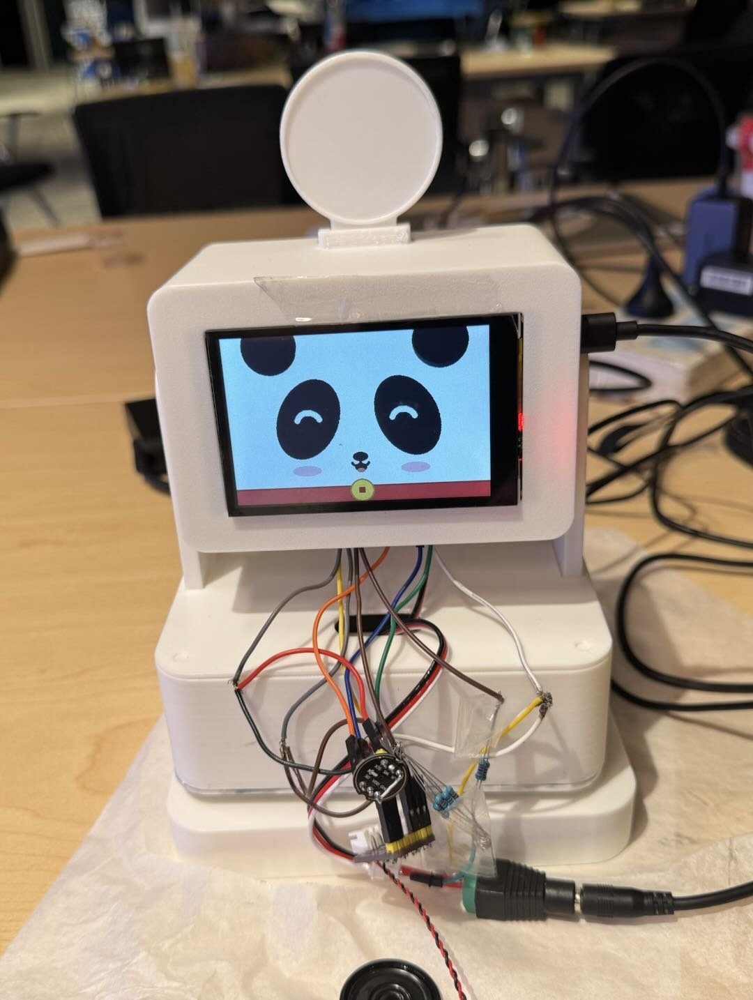
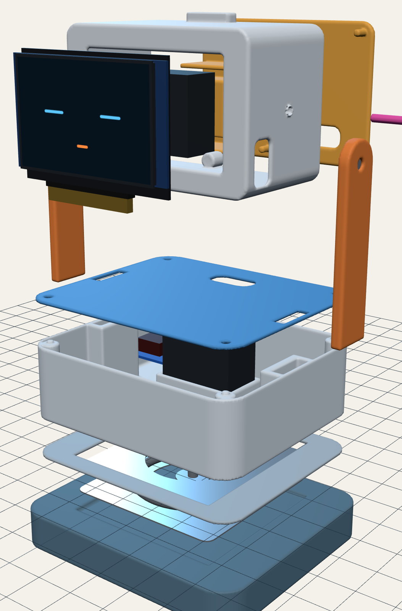
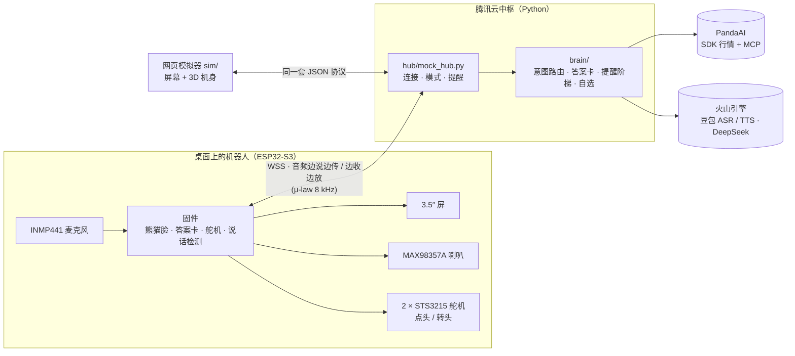
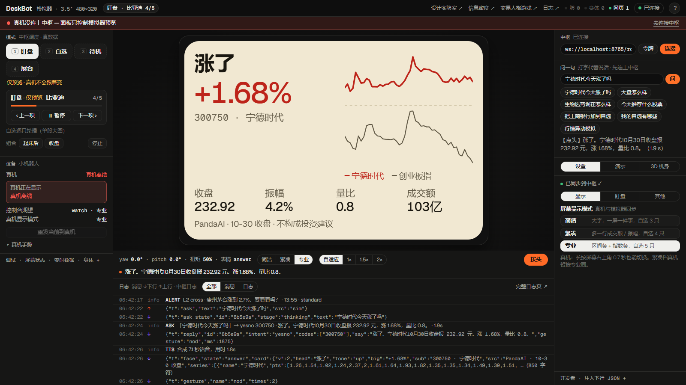
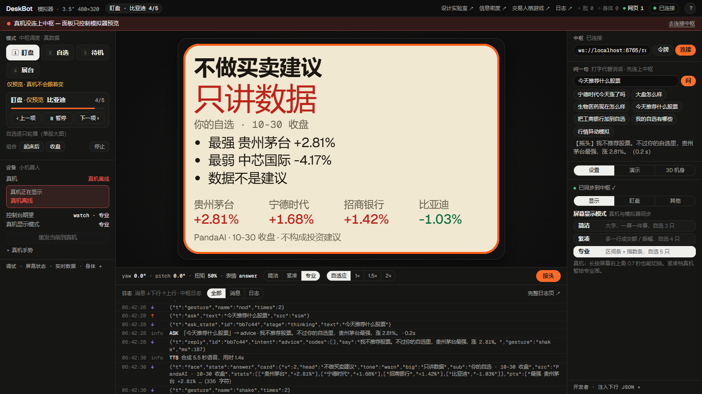
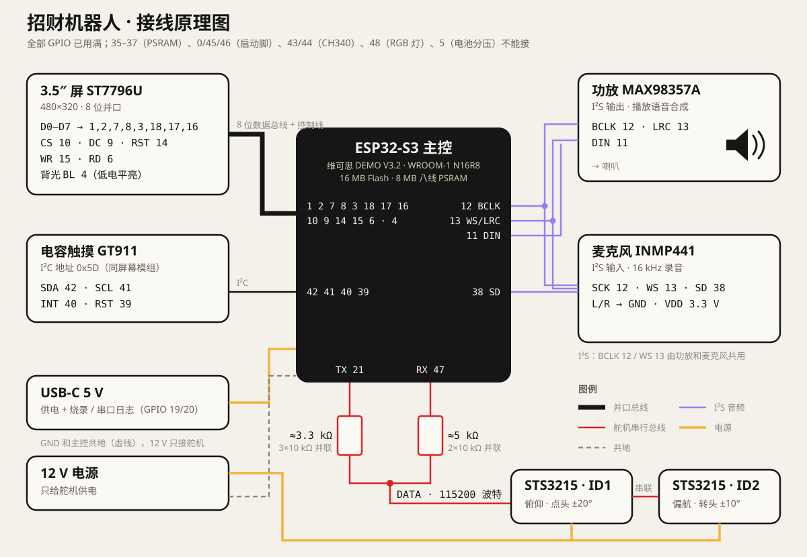

<div align="center">

# 🐼 招财机器人

**招财机器人，为你带来财运**

会看行情、会说话、会点头摇头的桌面熊猫。开口问一句，它用 PandaAI 的真实数据当场回答；<br>自选股异动时它转过头来提醒你；问它荐股，它摇头。


**赛道：AI+生活办公 · 赞助商 PandaAI 赛道**　|　团队：招财机器人

[🎬 30 秒演示视频](pitch/AI+生活办公+PandaAI-招财机器人-视频.mp4) ·
[🖥️ 不用硬件，用模拟器验证](#-不用硬件5-分钟用模拟器验证) ·
[🔌 接线原理图](#-硬件与原理图)




</div>

---

## ✨ 它能做什么

| | 你做什么 | 它怎么反应 | 数据从哪来 |
|---|---|---|---|
| 🎙️ **语音问答** | “宁德时代今天涨了吗？” | 屏幕弹出答案卡（结论、大数字、分时走势、指标），喇叭念出来，**点头** | PandaAI 行情 / 指数 / 行业 |
| 🔎 **自由提问** | “昨天龙虎榜成交额最大的是哪只？” | 大模型调用 PandaAI MCP 的工具去查，说出来的数字要能在返回数据里找到 | PandaAI MCP（305 个接口） |
| 🚨 **主动提醒** | 什么都不用做 | 自选股接近阈值时瞥一眼；跌破 / 涨破 ±2% 时**转头看你**、出卡、念出来 | PandaAI 5 分钟线 |
| 🧪 **行情异动模拟** | 周末说“行情异动模拟” | 以最近收盘为基准，现场演一遍异动提醒（卡片标“模拟”） | 最近收盘价 |
| ⭐ **语音改自选** | “把工商银行加到自选” / “我的自选有哪些” | 点头确认，自选列表更新 | 5,223 只 A 股名称库（拼音纠错） |
| 🙅 **不荐股** | “今天推荐什么股票？” | **摇头**：不做买卖建议，只把数据讲清楚 | — |
| 🐼 **招财熊猫脸** | 待机 | 熊猫跟着两个舵机一起动：开机摇头笑一笑，听的时候竖耳朵，想的时候冒泡，没事玩铜钱、睡觉 | — |
| 🤫 **不乱接话** | 旁边人在聊天 | 不是对它说的话不理（今晚实测 6 段别人的聊天，一句没搭理） | — |

> 原则：**Python 算数，大模型只组织语言。** 涨跌幅、排名、对比都由代码从 PandaAI 数据算出来；大模型说的每个数字都要在工具返回里找得到，对不上就不说数字。

---

## 🧭 系统怎么搭的



一句话的旅程（今晚实测）：你说话（边说边传）→ 豆包识别 **0.5–0.9 s** → PandaAI 取数 **约 1.2 s** → 合成语音 **约 1.5 s** → 屏幕出卡、点头 / 摇头、开口。

| 层 | 目录 | 说明 |
|---|---|---|
| 固件 | `esp32s3/bringup/` | PlatformIO + Arduino + TFT_eSPI。整帧画进 PSRAM 再推屏（约 75 ms 一帧）；μ-law 音频收发；舵机动作全部夹在开机摆动的范围里 |
| 联网 | `shared/`、`config/` | Wi-Fi（主 + 备用热点）、WSS 连云端中枢、令牌握手 |
| 中枢 | `hub/` | WebSocket 服务、模式引擎、问答助手（`assistant.py`）、提醒、日志 |
| 大脑 | `brain/` | `router.py` 规则意图 + 拼音纠错 · `qa.py` 答案卡 · `agent.py` 大模型 + MCP · `alerts.py` 提醒阶梯 · `anomaly_sim.py` 异动模拟 · `watchlist.py` 自选 · `series.py` 2,031 个指数 · `sectors.py` 21 个行业 |
| 数据 | `data/` | PandaAI 客户端、名称库 |
| 模拟器 | `sim/` | 网页版“假机器人”：屏幕、3D 机身、日志、打字问答 |
| 部署 | `deploy/` | nginx（HTTPS / WSS）、systemd、一键 `setup.sh` |
| 演示 | `pitch/` | 30 秒演示视频、实物照片、拆解图 |

---

## 🖥️ 不用硬件，5 分钟用模拟器验证

这是硬件项目，但机器人和中枢之间只说一套 JSON 协议。**网页模拟器说的是和真机一模一样的协议**：屏幕画同样的答案卡，3D 机身做同样的点头 / 摇头 / 转头。评审不需要板子，用模拟器就能把语音问答、不荐股、提醒、改自选完整走一遍。



### 0. 准备

- [uv](https://docs.astral.sh/uv/)（Python 包管理，会自动装 Python 3.12）
- 一个 PandaAI 账号（行情数据要它）
- 任意浏览器

### 1. 填账号

```bash
cp data/.env.example data/.env      # 然后填 DEFAULT_USERNAME / DEFAULT_PASSWORD（PandaAI 手机号和密码）
```

语音和大模型的 key 是可选的：不填时打字问答照常，只是中枢不合成语音、规则答不了的自由提问不回答。

### 2. 启动中枢（终端 1）

```bash
uv run python hub/mock_hub.py
```

看到 `mock hub  ws://…:8765/robot` 就好了。本机连接不需要令牌。第一次运行会装依赖、拉名称库，稍等一会儿。

### 3. 启动模拟器（终端 2）

```bash
python -m http.server 8090 -d sim
```

### 4. 打开 http://localhost:8090 ，右上角点「连接」，然后在「问一句」里提问

点下面的示例按钮，或者自己打字（回车发送）：

| 试试这句 | 应该看到 |
|---|---|
| 宁德时代今天涨了吗 | 答案卡：结论 + 涨跌幅 + 分时（对比创业板指）+ 收盘 / 振幅 / 量比 / 成交额；3D 机身**点头** |
| 大盘怎么样 · 生物医药现在怎么样 | 指数卡 / 行业卡，最新一天和近 5 个交易日 |
| 今天推荐什么股票 | 橙框卡「不做买卖建议 · 只讲数据」，**摇头** |
| 把工商银行加到自选 · 我的自选有哪些 | 自选增删，点头确认 |
| 行情异动模拟 | 依次弹出异动提醒卡，机身**转头**看你 |
| 今天天气不错（不是对它说的） | 不接话 |



每一条上下行消息都在页面下方的日志里（`{"t":"ask"}` → `ask_state` → `reply` → `face: answer` → `gesture`），和真机收到的完全一样。浏览器会用自带的中文语音把回答念出来（真机上是中枢合成的豆包语音）。

### 只想看界面，不配账号

只做第 3 步，打开 http://localhost:8090 。不连中枢时模拟器用示例数据本地轮播：

- `?demo=all`：自动播放使用场景（左栏也可以切 盯盘 / 自选 / 待机 / 展台）
- 右栏「3D 机身」：看身体动作；按 `?` 看全部快捷键
- 还有：[设计实验室](sim/lab.html)（屏幕版式旋钮）、[信息密度原型](sim/dense.html)、[日志页](sim/logs.html)、[交易人格游戏](sim/game.html)（PandaAI 赛道 H5）

### 跑测试

```bash
uv run --group dev pytest        # 78 passed：意图路由、拼音纠错、自选、提醒阶梯、答案卡
```

---

## 🔌 硬件与原理图



| 部件 | 型号 | 接到 ESP32-S3 |
|---|---|---|
| 主控 | 维可思 ESP32-S3 DEMO V3.2（WROOM-1 **N16R8**：16 MB Flash · 8 MB PSRAM） | — |
| 屏幕 | 3.5″ 480×320 **ST7796U**，8 位并口 | D0–D7 = 1, 2, 7, 8, 3, 18, 17, 16 · CS 10 · DC 9 · RST 14 · WR 15 · RD 6 · 背光 4（低电平亮） |
| 触摸 | **GT911** 电容触摸（I²C 0x5D） | SDA 42 · SCL 41 · INT 40 · RST 39 |
| 喇叭功放 | **MAX98357A** | BCLK 12 · LRC 13 · DIN 11 |
| 麦克风 | **INMP441** | SCK 12 · WS 13 · SD 38（L/R 接地，3.3 V） |
| 舵机 × 2 | 飞特 **STS3215-12V**，串联在一条总线上 | TX 21 → ≈3.3 kΩ → DATA ← ≈5 kΩ ← RX 47；**115200 波特**；12 V 单独供电，与主控共地 |
| 结构 | 头盒、身体、底座全部 3D 打印 | — |

- **ID1 = 俯仰（点头，±20°），ID2 = 偏航（转头，±10°）**。所有动作都限制在开机摆动的范围内，屏幕上的熊猫脸跟着舵机的实际角度一起动。
- 舵机是半双工单线总线，用两个电阻把 TX / RX 合到 DATA 上；板子会先收到被电阻削弱的自己发出去的回显，驱动在字节流里找 `FF FF ID` 帧头再读。
- 板子的 GPIO 已经全部用完。完整引脚、排针位置、舵机基准、音频细节见 [《开发交接》§2](开发交接.md)；厂家的主控板和屏幕原理图 PDF 见 [esp32s3/README.md](esp32s3/README.md)。

---

## 🔧 真机运行

<details>
<summary>编译、烧录固件，部署云端中枢（点开）</summary>

工具：`uv`；PlatformIO 用 `uvx` 调用，不用单独安装。

```bash
# 1) 网络：config/network.json 是公共配置（云端域名、端口）
#    自己的 Wi-Fi / 热点写在 config/network_local.json（不进 git）：
#    {"wifi": {"ssid": "...", "password": "..."}, "fallback": [{"ssid": "...", "password": "..."}]}
python config/build_net.py                 # → config/deskbot_net.h + deskbot_net_local.h（含中枢令牌）

# 2) 中文字体（每台电脑生成一次，只在改字体时重烧）：步骤见《开发交接》§4
python esp32s3/tools/pack_fonts.py
uvx esptool --port COM13 write-flash 0x410000 esp32s3/bringup/fonts.bin

# 3) 固件（Windows 是 COMx，macOS 是 /dev/cu.usbmodem*）
uvx --python 3.12 --from platformio pio run -d esp32s3/bringup -t upload --upload-port COM13
```

云端中枢（Ubuntu + nginx + certbot，HTTPS / WSS 走 443）：

```bash
sudo bash deploy/setup.sh                  # 装依赖、systemd 服务 deskbot-hub、nginx 反向代理到 127.0.0.1:8765
```

中枢在 `--proxy` 模式下只听本机端口，所有连接都要令牌（`hub/.token`）。板子开机连 Wi-Fi → WSS 握手 → 熊猫开机动画 → 待命。

</details>

---

## 🔐 密钥

所有密钥都只放在本地、不进 git：`data/.env`（PandaAI 账号、火山引擎 key）、`hub/.token`（中枢令牌）、`data/mcp_token.json`（PandaAI MCP 授权）、`config/network_local.json`（Wi-Fi 密码）。模板见 [`data/.env.example`](data/.env.example)。

---

## 🗓️ 进度

10-30 完成产品设计、3D 打印全部结构件；10-31 完成线路设计、调试和组装；11-01 接入 PandaAI、豆包语音和 DeepSeek，上线云端中枢。

更多文档：[开发交接](开发交接.md) · [交互设计](交互设计.md) · [动作对照](动作对照.md) · [异常处理](异常处理.md) · [数据清单](数据清单.md) · [设计系统](design/README.md)

<sub>行情数据来自 PandaAI，仅供参考，不构成投资建议。 · MIT License</sub>
